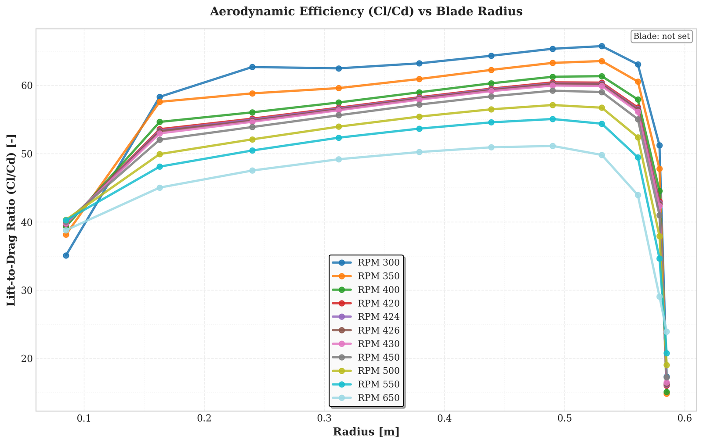
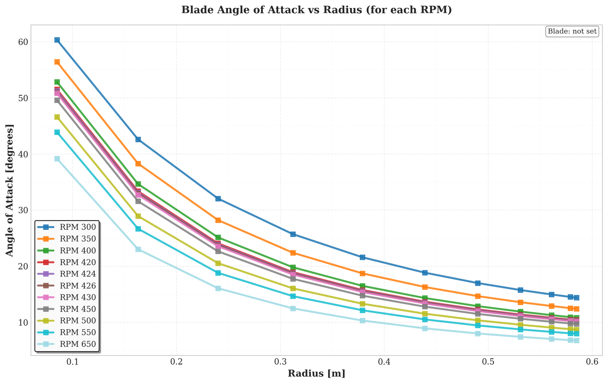
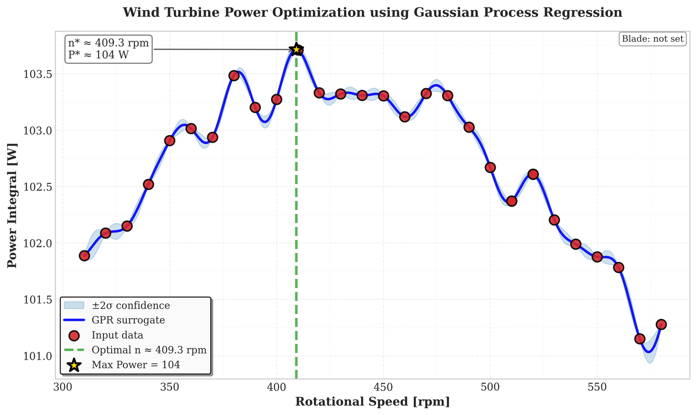
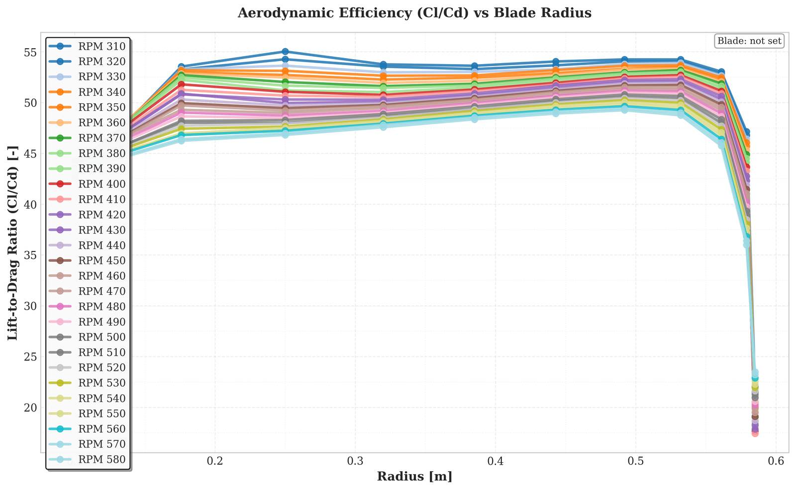

# Wind Turbine Power–RPM Optimization with Gaussian Process Regression

A Python tool that finds the **optimal rotor speed of a small wind turbine** from blade-element data.
It reads aerodynamic results for a set of rotational speeds, integrates the blade torque into power,
fits a **Gaussian process regression (GPR)** surrogate of power vs. RPM with a 95 % confidence band,
and searches it for the maximum. It also plots lift-to-drag ratio and angle of attack along the blade,
and offers a small GUI and a command line for quick predictions.

Developed for the micro-wind turbine design project, M.Sc. Energy Engineering, University of Padova
(Prof. Giorgio Pavesi), 2025.


## Results on the included data

| Blade airfoil | Optimal speed | Maximum power integral | GPR kernel (fitted) |
|---|---|---|---|
| E176 (truncated) | **426.9 rpm** | **≈ 105.0 W** | 1.09² · RBF(ℓ = 0.376) |
| S900 (truncated) | **409.3 rpm** | **≈ 103.7 W** | 0.894² · RBF(ℓ = 0.136) |

Both blades peak in a narrow band around 410–430 rpm; the confidence band widens where the RPM samples
are sparse (above 550 rpm), which shows where more data would improve the surrogate.

| Lift-to-drag ratio along the blade (E176) | Angle of attack along the blade (E176) |
|---|---|
|  |  |

| Power vs RPM (S900) | Lift-to-drag ratio along the blade (S900) |
|---|---|
|  |  |

## How it works

1. **Parse** the CSV: each block starts with a row `n, <rpm>`, followed by a header row and one row per
   blade station until a blank or non-numeric radius. Numbers are cleaned robustly (thousand separators,
   units, scientific notation with spaces).
2. **Power per RPM**: torque is integrated along the radius and multiplied by ω = 2πn/60; if no torque
   column exists, a power-integral column is used instead.
3. **Surrogate**: the RPM and power values are standardized and fitted with a GPR (constant × RBF
   kernel, multiple optimizer restarts).
4. **Optimum**: the surrogate is evaluated on a dense 2000-point RPM grid and its maximum is reported,
   with a warning if a query falls outside the data range.
5. **Plots**: power vs. RPM with ±2σ band, C<sub>l</sub>/C<sub>d</sub> and angle of attack vs. radius,
   and (when blade diameter, air density and wind speed are entered in the GUI) the power coefficient
   compared with the Betz limit.

## Usage

```bash
python -m pip install -r requirements.txt

# run on an included dataset: prints the optimum, saves figures to figures/
python src/rpm2.py --csv data/E176_truncated.csv

# predict power at a given speed without plotting
python src/rpm2.py --csv data/E176_truncated.csv --rpm 450 --no-plot

# interactive tools
python src/rpm2.py --csv data/E176_truncated.csv --gui       # query any RPM
python src/rpm2.py --csv data/E176_truncated.csv --results   # summary window

# no --csv: dialogs ask for blade model, diameter, air density, wind speed and the CSV file
python src/rpm2.py
```

Run the commands from the repository root (figures are written to `figures/`).
Python 3.10+; Tkinter is needed only for the GUI options. `pip install SciencePlots` gives
journal-style plots (optional).

## Repository structure

```
├── src/
│   └── rpm2.py                 GPR pipeline, plots, GUI and CLI
├── data/
│   ├── E176_truncated.csv      blade-element results per RPM, E176 airfoil
│   └── S900_truncated.csv      blade-element results per RPM, S900 airfoil
├── figures/                    plots generated from the included data
├── assets/                     logos shown in the GUI windows
└── requirements.txt
```

## Author

**Kaleb Kassa Lafebo**, M.Sc. Energy Engineering, University of Padova.
[LinkedIn](https://www.linkedin.com/in/kaleb-kassa) · [GitHub](https://github.com/Kaleb-kass)
