# Design and ML-Driven Optimization of a Micro-Scale Wind Turbine

Design of a three-bladed micro wind turbine (rotor diameter **1.17 m**, **E176-Truncated** airfoil) from
measured site wind data to a verified 3D CFD model:

1. **Wind data analysis**: Weibull statistics of one year of 10-minute wind data.
2. **Blade design (BEM)**: optimal blade geometry with the Blade Element Momentum method.
3. **ML optimization**: a Python tool that fits a **Gaussian process regression** surrogate of power vs.
   rotor speed and finds the optimal operating point (code in this repository).
4. **CFD verification**: steady 3D simulation of the final rotor in **Ansys CFX** from cut-in to cut-out.

Course project for **Wind and Hydraulic Turbines** (INQ2100369), M.Sc. Energy Engineering,
University of Padova. Instructor: Prof. Giorgio Pavesi.

📄 **Presentation:** [`presentation/Micro-Scale-Wind-Turbine-Design-Presentation.pdf`](presentation/Micro-Scale-Wind-Turbine-Design-Presentation.pdf)

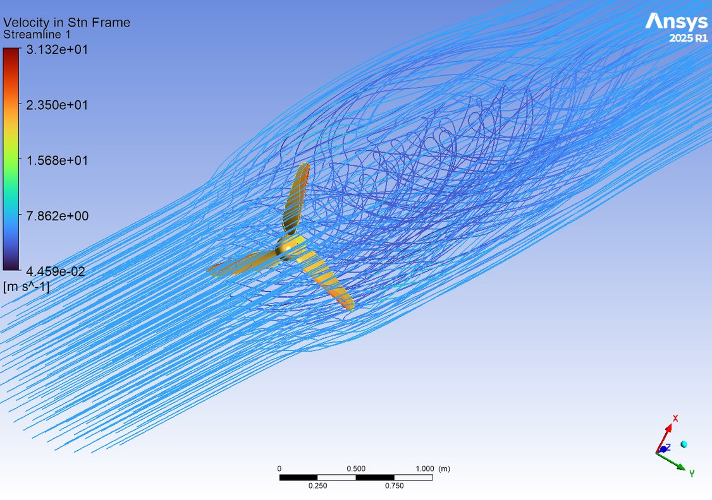

## Key results

| Quantity | Result | Source |
|---|---|---|
| Design / nominal wind speed | 7 m/s / 12.5 m/s (cut-in 3 m/s, cut-out 20 m/s) | Weibull analysis |
| Optimal rotor speed | **426.9 rpm** | GPR surrogate |
| Power coefficient at the optimum | **C<sub>p</sub> = 0.487**, 82.2 % of the Betz limit (0.593) | BEM + GPR, 7 m/s |
| Optimal tip-speed ratio | **λ ≈ 3.7** (C<sub>p</sub> approaching 0.49) | BEM |
| Shaft power from CFD | ≈ 90 W at 7 m/s · ≈ 167 W at 12.5 m/s (rated) · ≈ 270 W at 20 m/s | Ansys CFX |
| Peak power coefficient from CFD | **C<sub>p</sub> ≈ 0.42** at 6–7 m/s | Ansys CFX |

## 1. Wind data analysis

Wind measurements from a site in Turkey (10-minute mean speeds over more than a year) were fitted with a
Weibull distribution to find the mean speed and the speed that carries the most energy. This set the
operating window: cut-in 3 m/s, design 7 m/s, nominal 12.5 m/s, cut-out 20 m/s.

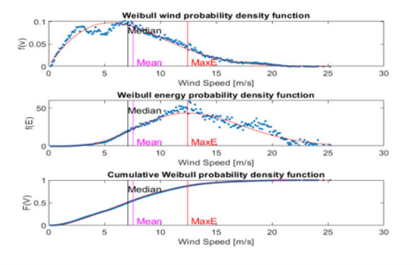

## 2. Blade design (BEM)

The **E176-Truncated** airfoil was chosen for low-Reynolds operation: a high lift-to-drag ratio for an early
cut-in, a blunt trailing edge that is stronger and easier to manufacture, and a forgiving stall behaviour.
The blade geometry (chord and twist distribution) was optimized with the Blade Element Momentum method.

| Final blade geometry | Blade in the periodic CFD domain |
|---|---|
| 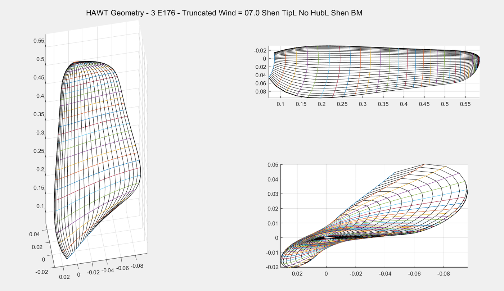 | 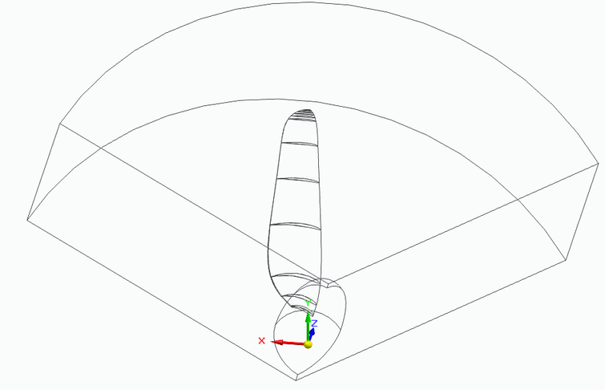 |

## 3. ML optimization tool (this repository)

Blade-element results at a set of rotor speeds (`data/`) are turned into a smooth power curve:

1. **Parse** each speed block of the CSV (radius, torque, C<sub>l</sub>, C<sub>d</sub>, angle of attack).
2. **Integrate** torque along the radius and multiply by ω = 2πn/60 to get the power at each speed.
3. **Fit** a Gaussian process (constant × RBF kernel, standardized data, 25 optimizer restarts).
4. **Search** the surrogate on a 2000-point speed grid for the maximum, with a ±2σ confidence band.
5. **Compare** with the ideal power ½ρAV³ to get C<sub>p</sub> and the gap to the Betz limit.

| Power vs. rotor speed | C<sub>p</sub> vs. Betz limit |
|---|---|
| 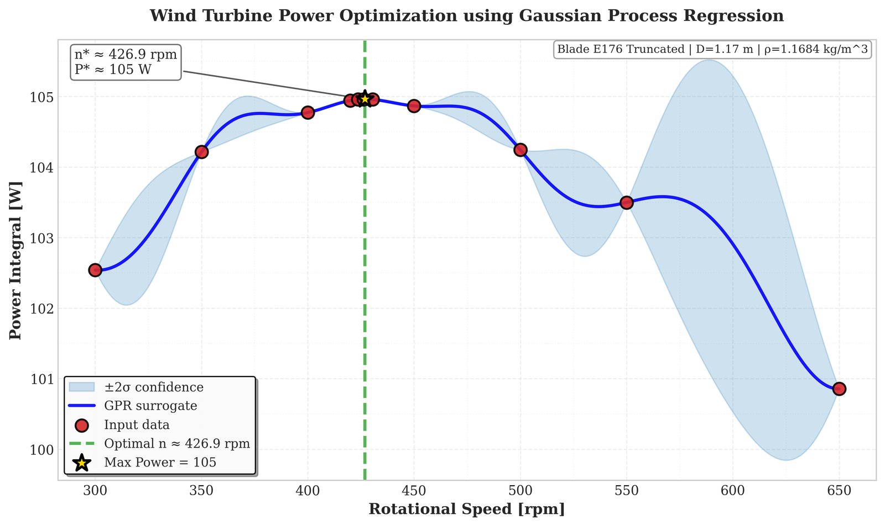 | 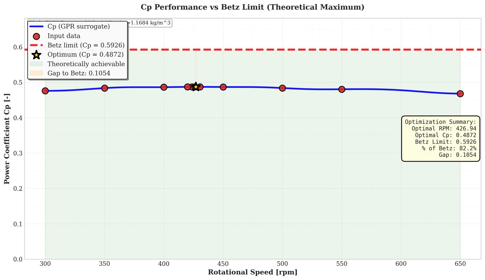 |

| Lift-to-drag ratio along the blade | Angle of attack along the blade |
|---|---|
|  | 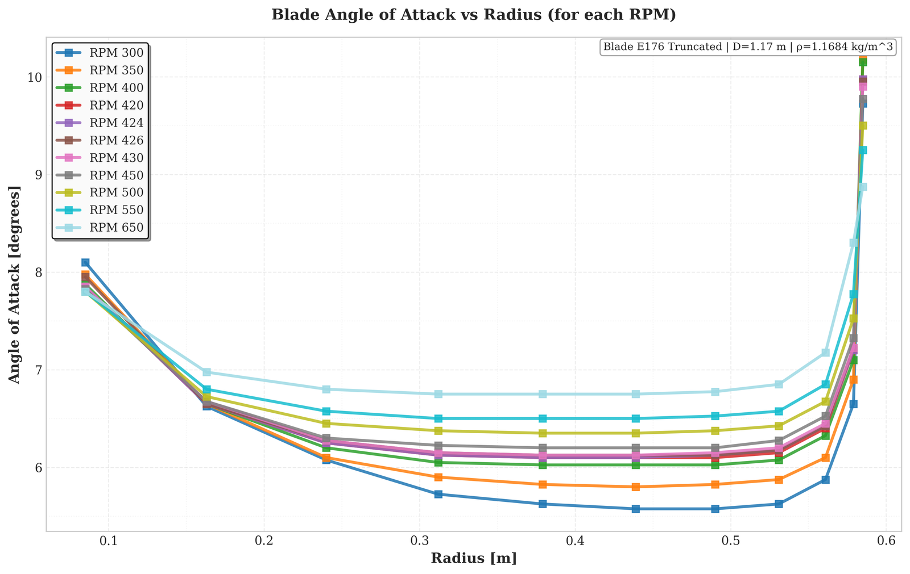 |

Along most of the span the blade works at an angle of attack of about 5.5–8°, rising to about 10° only at the
very tip, so it stays well below stall (about 18–20°) at every rotor speed. The lift-to-drag ratio peaks at
about 60 near the optimum speed and is highest at low speeds.

The same analysis on the **S900-Truncated** airfoil (`data/S900_truncated.csv`) gives an optimum at
409.3 rpm; its plots are in `figures/optimization/`.

## 4. CFD verification (Ansys CFX)

**Mesh**: a structured mesh in the outer (ambient) domain for fast, accurate convergence, and an unstructured
mesh in the rotating pocket around the hub and blade, sized from the finest ambient cells (scale factor 10).
Only one blade is modelled, using rotational periodicity.

| Ambient domain (structured) | Rotor pocket (unstructured) |
|---|---|
| 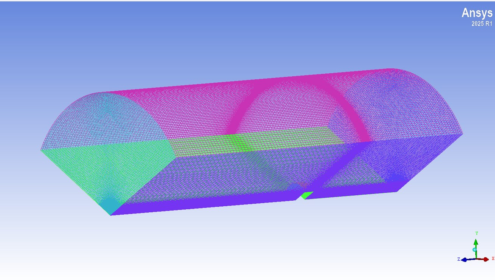 | 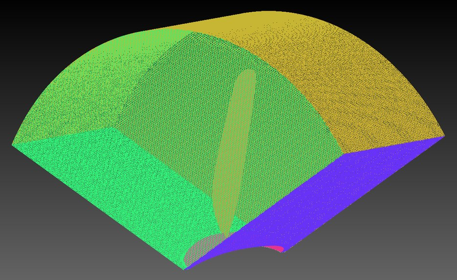 |

**Boundary conditions**: uniform inlet velocity (varied from cut-in to cut-out), average static pressure at
the outlet, an opening at the top, rotational periodicity on the side walls, and rotating no-slip walls on
the blade and hub. Axial force and torque were monitored until both were flat (steady state).

| Boundary conditions | Convergence of axial force and torque |
|---|---|
| 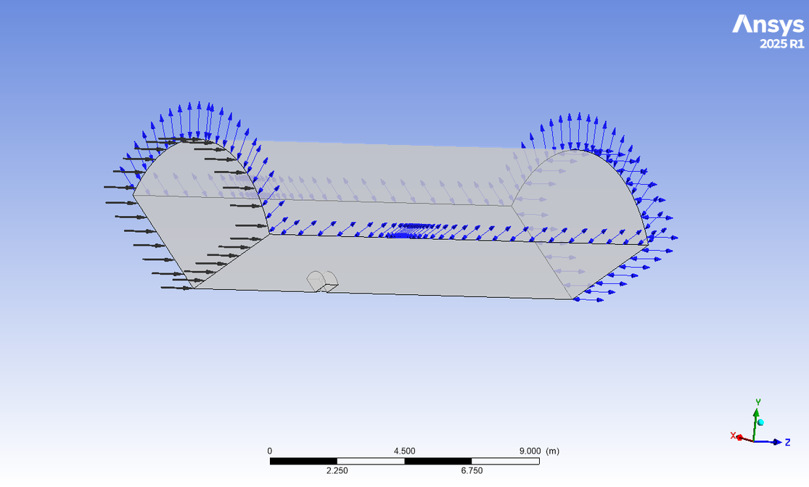 | 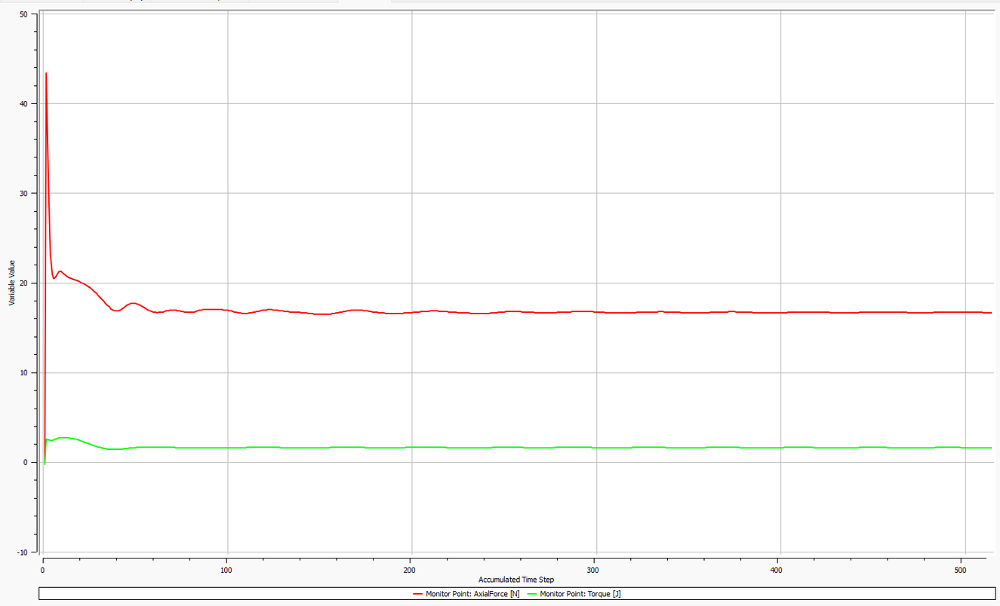 |

### Results

| Velocity vectors, design condition | Velocity vectors, cut-out condition |
|---|---|
| 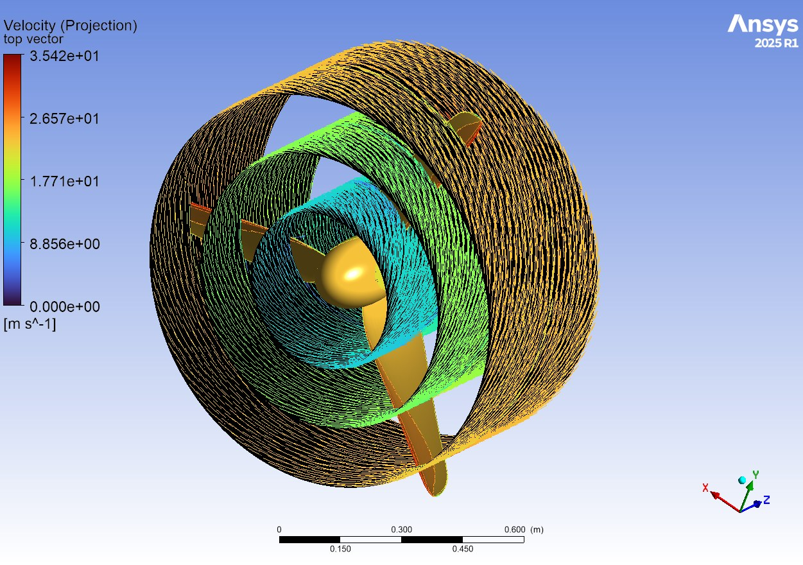 | 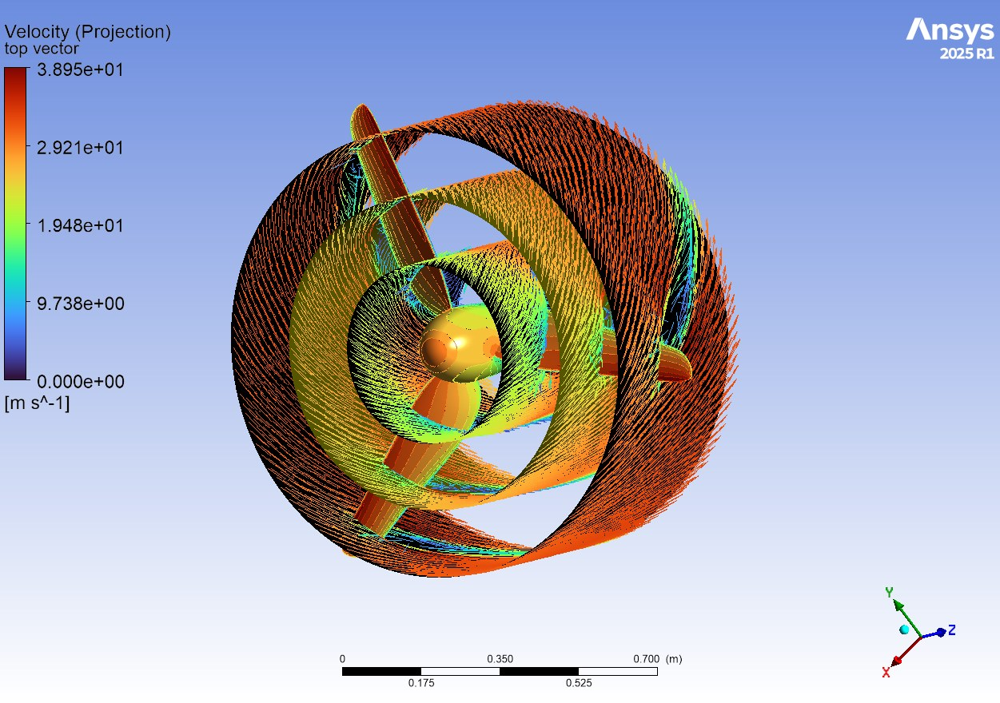 |

| Pressure on the blade section: cut-in | design | cut-out |
|---|---|---|
| 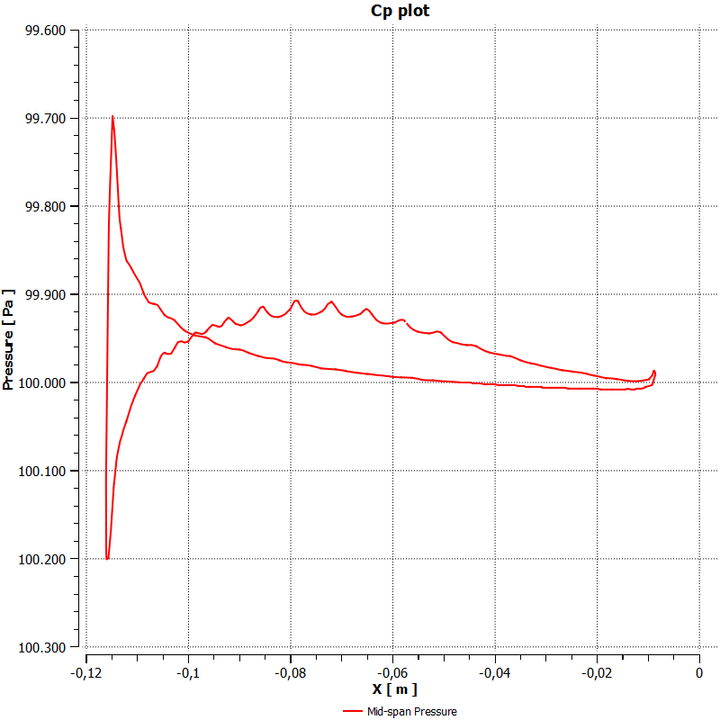 | 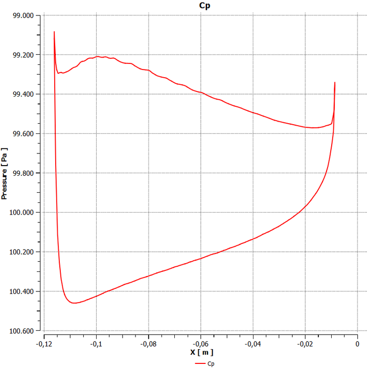 | 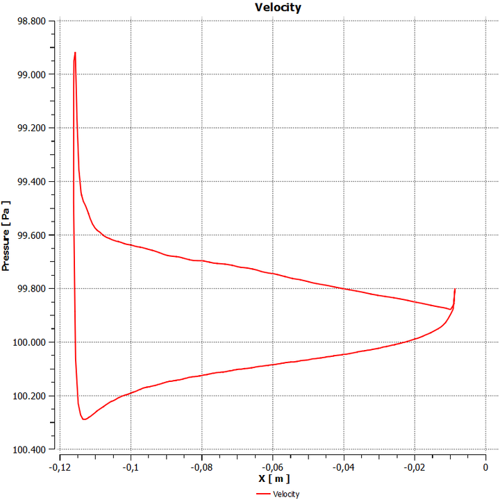 |

| Power and C<sub>p</sub> vs. wind speed (CFD) | Power curve with cut-in, nominal and cut-out control |
|---|---|
| 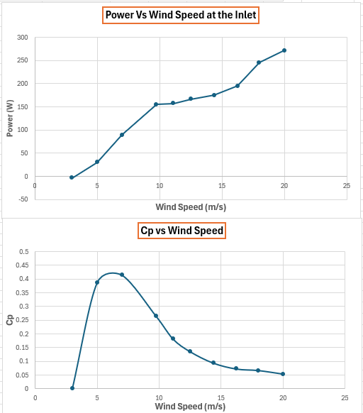 | 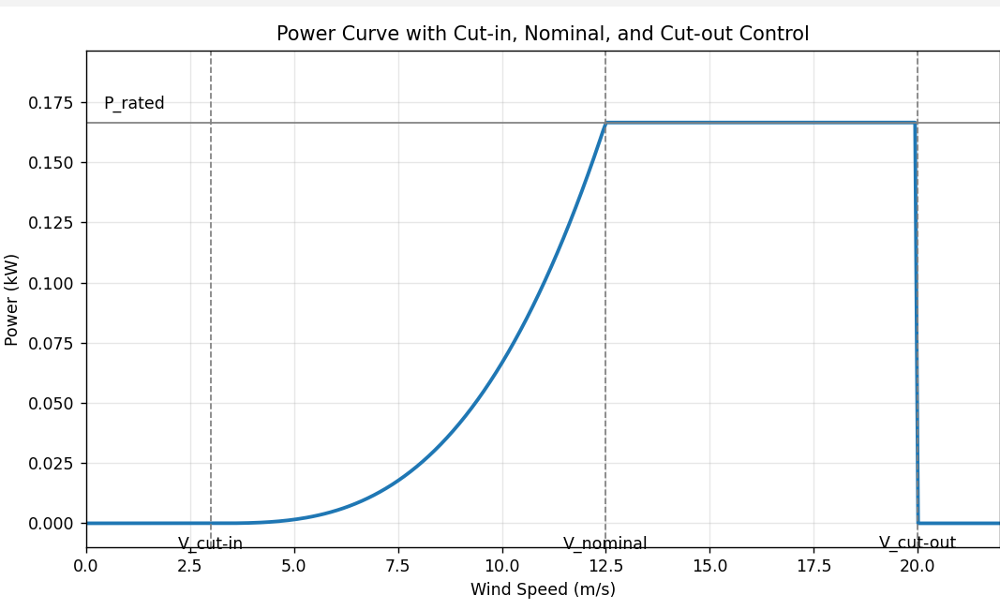 |

Power rises from cut-in to the nominal speed of 12.5 m/s, where it is held at the rated value by
fixed-pitch variable-speed control until the 20 m/s cut-out. C<sub>p</sub> peaks at about 0.42 near the
7 m/s design speed and falls at high wind speeds as the blade moves away from its optimal tip-speed ratio.

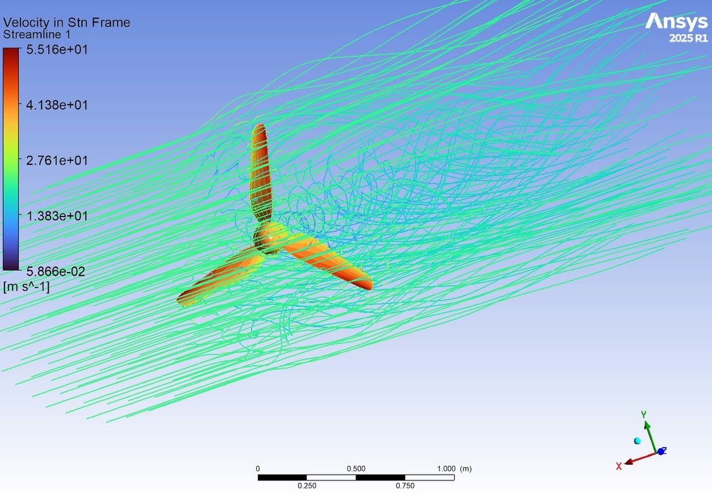

## Run the optimization tool

```bash
python -m pip install -r requirements.txt

# full analysis of the final blade (reproduces the presentation: 426.9 rpm, Cp = 0.4872)
python src/rpm2.py --csv data/E176_truncated.csv --model "E176 Truncated" --diameter 1.17 --rho 1.1684 --wind-speed 7

# predict power at a given speed without plotting
python src/rpm2.py --csv data/E176_truncated.csv --rpm 450 --no-plot

# interactive windows
python src/rpm2.py --csv data/E176_truncated.csv --gui       # query any rotor speed
python src/rpm2.py --csv data/E176_truncated.csv --results   # summary window

# no arguments: dialogs ask for the blade data and the CSV file
python src/rpm2.py
```

Run from the repository root; figures are written to `figures/`. Python 3.10+; Tkinter is needed only for
the interactive windows. `pip install SciencePlots` gives journal-style plots (optional).
The `--diameter`, `--rho` and `--wind-speed` options enable the C<sub>p</sub> and Betz-limit outputs.

## Repository structure

```
├── presentation/   project presentation (PDF)
├── src/
│   └── rpm2.py     GPR optimization tool: parsing, surrogate, plots, GUI and CLI
├── data/           blade-element results per rotor speed (E176 and S900 airfoils)
├── figures/
│   ├── wind-data/      Weibull analysis
│   ├── bem/            blade geometry
│   ├── optimization/   plots generated by src/rpm2.py
│   └── cfd/            Ansys CFX mesh, set-up and results
├── assets/         logos shown in the tool's windows
└── requirements.txt
```

## Author

**Kaleb Kassa Lafebo**, M.Sc. Energy Engineering, University of Padova.
[LinkedIn](https://www.linkedin.com/in/kaleb-kassa) · [GitHub](https://github.com/Kaleb-kass)
